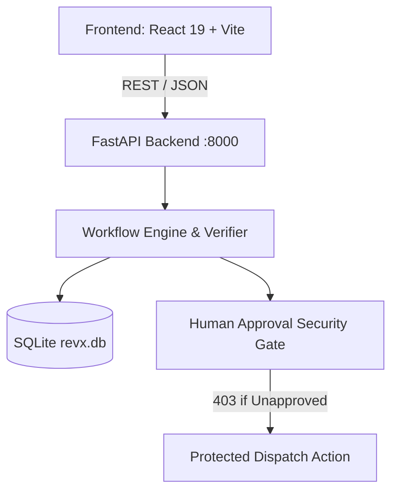

# REVX API Contract & Technical Specification

**REVX — Recover. Execute. Verify.**  
Autonomous workflow orchestration with observable execution, deterministic failure recovery, independent cryptographic verification, and human-in-the-loop authorization gates.

---

## 1. System Architecture



- **Frontend Origin**: `http://localhost:5173` (React 19, TypeScript, Vanilla CSS)
- **Backend API**: `http://127.0.0.1:8000` (FastAPI, Python 3.14, SQLAlchemy)
- **Database**: Local SQLite database at `./revx.db`
- **Interactive Documentation**: `http://127.0.0.1:8000/docs` (Swagger UI) & `/redoc`

---

## 2. API Endpoints Specification

### A. Health & System Status

#### `GET /health` / `GET /api/health`
Checks backend and SQLite connection availability.

**Response `200 OK`**:
```json
{
  "status": "healthy",
  "database": "connected",
  "version": "0.1.0",
  "timestamp": "2026-10-15T10:56:34.639829Z"
}
```

---

### B. Task Management

#### `POST /api/tasks`
Creates and initializes an autonomous task. Dispatches an execution run.

**Request Body**:
```json
{
  "title": "Internship Research & Pipeline",
  "description": "Research 2026 tech internships and save to sheet",
  "inject_failure": true
}
```

**Response `201 Created`**:
```json
{
  "id": "11aabd18-b628-414f-a8e1-09a639bf8026",
  "title": "Internship Research & Pipeline",
  "description": "Research 2026 tech internships and save to sheet",
  "status": "completed",
  "created_at": "2026-10-15T10:56:49.775469Z",
  "updated_at": "2026-10-15T10:56:50.224060Z"
}
```

**Errors**:
- `422 Unprocessable Content`: If `description` is blank or missing.

#### `GET /api/tasks`
Lists all tasks ordered by creation timestamp descending.

#### `GET /api/tasks/{task_id}`
Retrieves a single task by ID. Returns `404 Not Found` if missing.

---

### C. Execution Runs & Observability

#### `GET /api/runs`
Lists recent execution runs.

#### `GET /api/runs/latest`
Retrieves the most recent execution run with full details (steps, logs, verification report).

#### `GET /api/runs/{run_id}`
Retrieves a single run with full steps, activity log stream, and verification report.

#### `GET /api/runs/{run_id}/steps`
Retrieves execution steps for the run:
- `01 Research internships`
- `02 Save results`
- `03 Verify records`

#### `GET /api/runs/{run_id}/logs`
Retrieves timestamped activity logs (`info`, `warn`, `recover`, `success`, `error`).

#### `POST /api/runs/{run_id}/retry`
Retries or recovers an existing run, respecting idempotency keys to prevent duplicate database writes.

---

### D. Independent Verification

#### `GET /api/verifications`
Lists all cryptographic verification reports.

#### `POST /api/verifications/runs/{run_id}/reverify`
Re-runs an independent audit check over SQLite persisted rows:
1. Row count assertion matches expected evaluations.
2. Duplicate collision check (0 duplicates).
3. Mandatory schema fields validation.
4. Idempotency tokens confirmed (`REVX-TXN-`).
5. SHA-256 state tree digest matches planned signature.

**Response `200 OK`**:
```json
{
  "id": "VR-19162fc3",
  "run_id": "19162fc3-304d-4bab-8fb6-d681c38233b0",
  "target": "db.matching_results",
  "record_type": "Deterministic Row Integrity & Cryptographic Seal",
  "status": "verified",
  "sha256_digest": "a7d4e99f8028a01f90b281768c67270c84ae67252bbeb09ca822132a8a776b18",
  "assertions_passed": 5,
  "total_assertions": 5,
  "details": {
    "actual_count": 3,
    "expected_count": 3,
    "sha256": "a7d4e99f8028a01f90b281768c67270c84ae67252bbeb09ca822132a8a776b18"
  },
  "created_at": "2026-10-15T10:56:50.182842Z"
}
```

---

### E. Human Approvals & Protected Actions

#### `GET /api/approvals`
Lists pending and decided approval requests.

#### `POST /api/approvals/{approval_id}/decision`
Submits human operator decision (`approved` or `rejected`).

**Request Body**:
```json
{
  "decision": "approved",
  "reason": "Verified professional candidate qualifications",
  "actor": "Lead Operator"
}
```

**Errors**:
- `409 Conflict`: If the approval has already been decided.

#### `POST /api/approvals/{approval_id}/dispatch`
**Protected Action Execution Endpoint**:
- Enforces server-side security rule:
  - If `status != "approved"`: Returns `403 Forbidden` (`"PROTECTED ACTION BLOCKED: Operation requires approved human sign-off."`).
  - If `status == "approved"`: Marks `executed = True`, stages verified draft for transmission.
  - **Zero real external emails sent** (safe local demo sandbox).

---

## 3. Database Schema

- `tasks`: Task definitions and lifecycle status.
- `runs`: Execution attempts, failure-injection flags, start/end timestamps.
- `execution_steps`: Steps (`01`, `02`, `03`) with durations, attempt counters, and error recovery policies.
- `activity_logs`: Structured log stream with level tags (`[ORCHESTRATOR]`, `[STEP_01]`, `[AUTONOMOUS_RECOVERY]`).
- `sample_opportunities`: Seeded 2026 internship listings (Stripe, DeepMind, Figma, Cloudflare).
- `matching_results`: Persisted candidate eligibility matches with idempotency tokens.
- `verification_reports`: Cryptographic SHA-256 seal and evaluated assertions.
- `approval_requests`: Human-in-the-loop approval gate items and execution audit status.
- `audit_events`: Immutable audit trail for security compliance.
